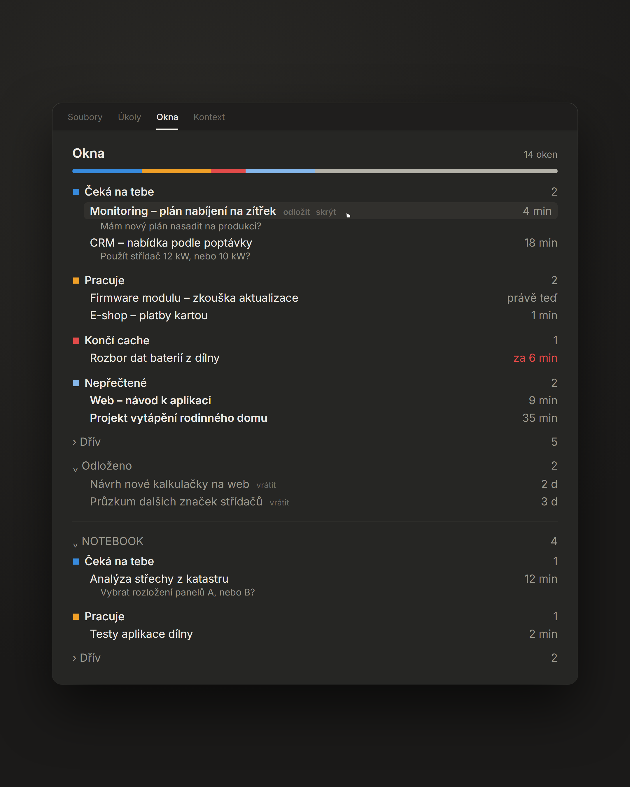

# okna — přehled oken Claude Code

Panel do aplikace Claude (záložka Code), který na jednom místě ukazuje všechna rozpracovaná okna:
kde Claude čeká na tvoje rozhodnutí, kde ještě pracuje, kde brzy vyprší cache a co jsi ještě nečetl.
Kliknutím na řádek se okno otevře.

*English summary at the bottom.*



## Proč

Když běží deset a víc oken najednou, snadno se ztratí to jedno, které už půl hodiny čeká na „ano/ne“.
Postranní seznam aplikace řadí okna podle času, ne podle toho, co chtějí od tebe. Panel je řadí podle toho,
co máš udělat:

- **Čeká na tebe** — Claude skončil a ptá se (otázka je vidět přímo pod názvem),
- **Pracuje** — právě běží,
- **Končí cache** — okno bylo naposledy aktivní před 50–60 min; když do něj napíšeš teď,
  pokračuje levně z cache (červeně „za 6 min“),
- **Nepřečtené** — Claude odpověděl a ty jsi okno od té doby neotevřel,
- **› Dřív** — ostatní, sbalené, menším písmem,
- **› Odloženo** — okna, která jsi odložil.

Volitelně barevný proužek nahoře (poměr skupin na první pohled).

## Odložit a skrýt

Na řádku (při najetí myší) jsou dvě akce:

- **odložit** — okno zmizí ze skupin dolů do „Odloženo“, dokud do něj znovu nenapíšeš
  (nebo ho tam nevrátíš tlačítkem **vrátit**). Hodí se na „teď ne, ale nezapomenout“.
- **skrýt** — okno z panelu zmizí úplně, dokud do něj nenapíšeš. Na okna, která vidět nepotřebuješ
  (třeba pravidelné úlohy).

Okna se stejným začátkem názvu jde skrýt trvale v nastavení (`hideTitles`, viz níže).

## Víc počítačů

Pracuješ-li na dvou PC, panel umí ukázat i okna druhého počítače — vlastní sekce s názvem PC
(např. „NOTEBOOK“) se stejnými skupinami. Kliknutí otevře okno přes Remote Control
(`claude://claude.ai/code/session_…`), i když běží na druhém PC. Na zdrojovém PC musí mít okno
zapnutý Remote Control.

Propojení jde přes **tvůj vlastní malý server** (viz [Server pro víc PC](#server-pro-víc-pc)).
Bez nastavení panel nic nikam neposílá — funguje jen lokálně.

## Instalace

V Claude Code (terminál nebo aplikace):

```
/plugin install okna --marketplace K3iVi/claude-okna
```

nebo z příkazové řádky:

```bash
claude plugin marketplace add K3iVi/claude-okna
```

```bash
claude plugin install okna@claude-okna
```

Pak `/reload-plugins` (nebo restart). Panel otevřeš příkazem `/okna` — v aplikaci se objeví jako záložka
„Okna“ vedle Souborů a Úkolů.

Aktualizace: `claude plugin marketplace update claude-okna` a `/reload-plugins`.

**Požadavky:** Windows a desktopová aplikace Claude (panel čte záznamy oken, které si aplikace ukládá
v `%LOCALAPPDATA%\Claude-Data`). macOS/Linux zatím ne — pull request vítán.

## Nastavení (nepovinné)

Soubor `%USERPROFILE%\.claude\okna.json`:

```json
{
  "hideTitles": ["^Denní kontrola", "^RC hlídač"],
  "sync": {
    "url": "https://okna.example.com",
    "key": "tvůj-tajný-klíč"
  }
}
```

- `hideTitles` — regulární výrazy (bez ohledu na velikost písmen); okna s takovým názvem se nezobrazí.
- `sync` — server pro víc PC. Adresa musí být `https://`. Bez `sync` se nic neposílá.

Po změně souboru `/reload-plugins`. Soubor obsahuje klíč — nedávej ho do gitu ani do sdílené složky.

## Server pro víc PC

Každé PC zhruba co 10 s pošle:

```
POST {url}/{název-PC}
Authorization: Bearer {key}
Content-Type: application/json

{"rows": [{"title": "…", "isRunning": false, "waiting": true, "unread": false,
           "snippet": "otázka…", "lastActivityAt": "2026-11-05T05:00:00Z",
           "rcLink": "claude://claude.ai/code/session_…"}]}
```

a server odpoví stavem ostatních PC se stejným klíčem:

```json
{"pcs": [{"pc": "NOTEBOOK", "at": 1762318800, "rows": [ … ]}]}
```

(`at` = unixový čas v sekundách; PC, které se neozvalo 15 min, server nevrací.)

Hotový vzorový server je v [`server/okna_server.py`](server/okna_server.py) (jen standardní knihovna Pythonu,
stav v paměti). Spustí se:

```bash
OKNA_KEYS=tvuj-klic python server/okna_server.py
```

Poslouchá na `127.0.0.1:8787`; panel mluví jen přes https, takže ho dej za reverzní proxy
(Caddy, nginx) nebo za `tailscale serve`.

### Zadání pro tvoje AI

Chceš-li to nechat udělat svého asistenta, zkopíruj mu tohle:

> Nastav mi synchronizaci pluginu Claude Code „okna“ (https://github.com/K3iVi/claude-okna) mezi mými počítači.
> 1. Na mém serveru (nebo jednom PC v síti Tailscale) spusť `server/okna_server.py` z toho repa jako službu
>    (systemd / Plánovač úloh), s náhodným klíčem v proměnné `OKNA_KEYS` (vygeneruj
>    `python -c "import secrets; print(secrets.token_urlsafe(32))"`), a zpřístupni ho přes HTTPS —
>    reverzní proxy (Caddy) nebo `tailscale serve --https=443 http://127.0.0.1:8787`.
> 2. Ověř `curl -X POST -H "Authorization: Bearer <klíč>" -d '{"rows":[]}' https://<adresa>/TEST`
>    → `{"pcs": []}`; se špatným klíčem 401.
> 3. Na každém mém PC zapiš `%USERPROFILE%\.claude\okna.json` s `{"sync": {"url": "https://<adresa>", "key": "<klíč>"}}`
>    (stávající obsah souboru zachovej). Klíč nevypisuj do chatu ani do logů, nedávej do gitu.
> 4. Řekni mi, ať v Claude spustím `/reload-plugins`.

## Přispívání

Nápady a chyby piš do [Issues](https://github.com/K3iVi/claude-okna/issues), úpravy posílej jako pull request —
viz [CONTRIBUTING.md](CONTRIBUTING.md).

## Licence

MIT — viz [LICENSE](LICENSE).

---

## English summary

**okna** is a Claude Code plugin for the desktop app (Windows) that adds an "Okna" (Windows) pane listing
all your sessions grouped by what they need from you: *waiting for you* (with the question), *working*,
*cache ending* (last active 50–60 min ago, cheap to continue now), *unread*, then folded *earlier* and
*deferred*. Click a row to open the session. Per row you can *defer* (move to "Deferred" until you write
into it) or *hide* it.

Optionally it shows sessions from your other PCs through a tiny sync server you run yourself
(`server/okna_server.py`, spec above) and opens them via Remote Control links. Without
`~/.claude/okna.json` nothing leaves your machine.

Install: `/plugin install okna --marketplace K3iVi/claude-okna`, then `/reload-plugins` and `/okna`.
The UI is in Czech; translations and macOS/Linux support are welcome as pull requests.
